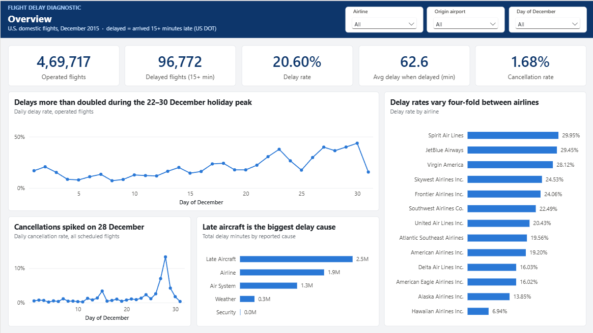
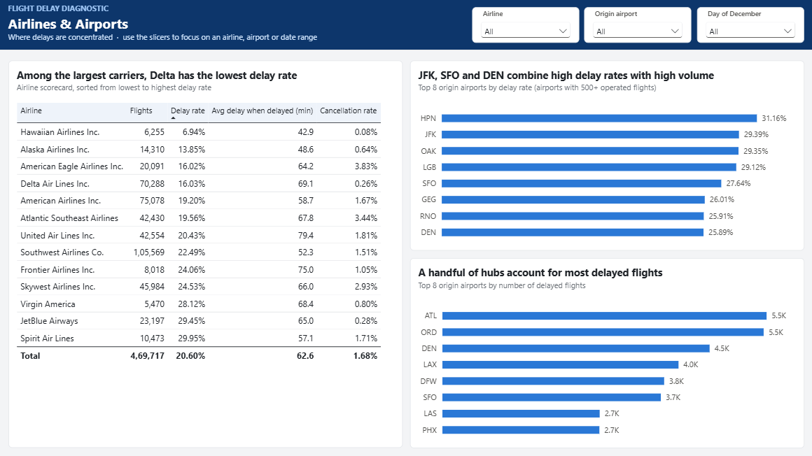
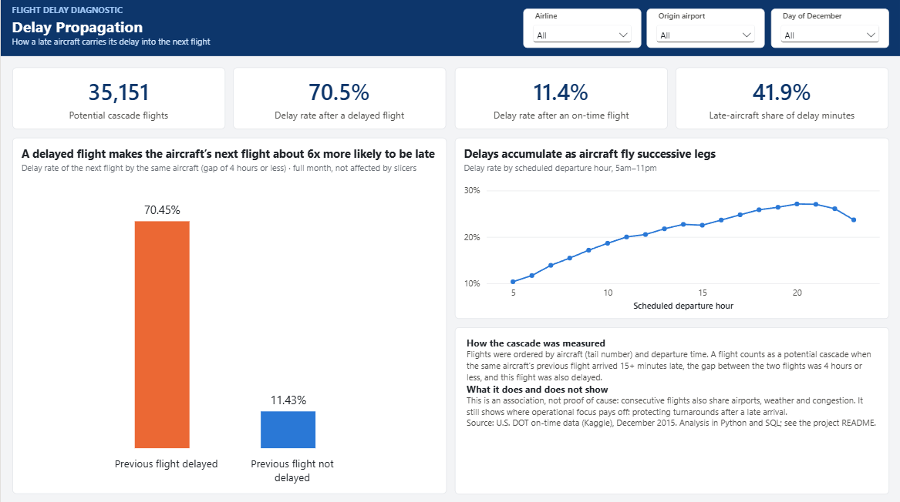

# ✈️ Flight Delay Diagnostic & Cascade Analysis

An end-to-end data analytics project analyzing **December 2015 U.S. flight operations** to understand flight delays, their causes, temporal patterns, airline/airport variation, and potential delay propagation between consecutive flights.

The project combines **Python, SQL, and Power BI** to move from raw flight data to validated analysis and an interactive analytical dashboard.



---

## 🧭 Executive Summary

**One in five operated flights (20.6%) arrived 15+ minutes late in December 2015, and most of that delay was operational and self-reinforcing rather than weather-driven.**

### Key findings

| # | Finding | Evidence |
| - | ------- | -------- |
| 1 | **Delays spread from flight to flight.** | 70.45% of flights were delayed when the same aircraft's previous flight was delayed, vs 11.43% when it was not (about 6x). Late-arriving aircraft caused **41.9%** of all delay minutes, the largest single cause. |
| 2 | **The holiday peak drove the month.** | 22–30 December had 28% of the month's flights but **47% of its delayed flights**; the daily delay rate averaged 33.5%, against 15.1% for 1–21 December. |
| 3 | **Delays build up through the day.** | Evening departures (5–9pm) were delayed **26.0%** of the time, about twice the rate of early-morning departures (5–8am, 13.3%). |
| 4 | **Performance differs widely between airlines.** | Delay rates ranged from 6.9% (Hawaiian) to 30.0% (Spirit). Among the largest carriers, Delta (16.0%) beat Southwest (22.5%) by 6.5 points. |
| 5 | **A few hubs carry a large share of the problem.** | The 10 origin airports with the most delayed flights account for 38% of all delayed flights. JFK (29.4%), SFO (27.6%) and DEN (25.9%) combine high volume with high delay rates. |

Recorded extreme-weather delay accounted for only **5.4%** of delay minutes; carrier (31.3%) and late-aircraft (41.9%) delays together made up about **73%**.

### Recommendations

These recommendations are for an airline operations team. They are based on observed associations, so each should be tested before being rolled out widely.

1. **Break the delay chain at turnaround.** Flag any aircraft arriving 15+ minutes late and give its next departure priority for gate, crew and ground handling, or swap in a standby aircraft at hubs. The 49,898 flights in the cascade analysis that followed a delayed flight are the target group; *as an illustration*, lowering their delay rate from 70% to 60% would avoid about 5,000 delayed flights (around 5% of the month's total).
2. **Plan the holiday peak as a separate operation.** Add reserve aircraft and crew, and more schedule buffer, for 22–30 December, when delay rates more than doubled.
3. **Add buffer to late-day schedules.** Lengthen scheduled turnaround times for afternoon and evening rotations, where accumulated delay is highest, rather than spreading buffer evenly across the day.
4. **Focus ground-operations improvement on a few hubs.** Start with JFK, SFO and DEN (high rate and high volume), then ATL and ORD (the most delayed flights in absolute terms).
5. **Benchmark against the best large carriers.** Compare Southwest's turnaround and scheduling practices with Delta's to understand the 6.5-point gap between two airlines of similar scale.

### Limitations

* One month of data (December 2015), so seasonal effects are strong; results should be checked against other months.
* The cascade analysis shows association, not causation: consecutive flights share airports, weather and congestion.
* Delay-cause minutes are reported by airlines and only recorded for delayed flights.

---

## 📌 Project Overview

Flight delays can result from multiple interacting factors, including airline operations, weather, air-system constraints, security issues, and delays inherited from earlier flights.

This project investigates:

* How frequently flights were delayed
* How severe the delays were
* Which airlines and airports experienced different delay patterns
* How delay rates varied by departure time and day
* Which operational causes contributed the most delay minutes
* Whether delays in preceding flights were associated with delays in subsequent flights

The final outcome is an interactive **Power BI Flight Delay Diagnostic Dashboard** supported by Python-based data preparation and SQL analysis.

---

## 🎯 Objectives

The primary objectives of the project were to:

1. Clean and prepare the flight dataset for analysis.
2. Isolate **December 2015** flight operations.
3. Identify cancelled and diverted flights and handle them appropriately.
4. Calculate overall flight volume and delay metrics.
5. Analyze delay patterns across airlines, airports and time periods.
6. Quantify the contribution of different delay causes.
7. Investigate potential **cascade effects**, where a delayed preceding flight is followed by another delayed flight.
8. Present the findings through an interactive Power BI dashboard.

---

## 📊 Dataset

**Source:** U.S. Department of Transportation flight-delay dataset, published on Kaggle as [2015 Flight Delays and Cancellations](https://www.kaggle.com/datasets/usdot/flight-delays).

The analysis focuses specifically on **December 2015**.

### Dataset after cleaning

| Metric                    |            Value |
| ------------------------- | ---------------: |
| Cleaned records           |      **479,230** |
| Operated flights          |      **469,717** |
| Delayed flights (≥15 min) |       **96,772** |
| Delay rate                |       **20.60%** |
| Average delay when delayed | **62.6 minutes** |
| Potential cascade flights |       **35,151** |

Cancelled and diverted flights were investigated separately because missing arrival-delay values were found to be associated with operational exceptions, particularly diverted flights.

---

## 🔍 Data Preparation

The raw dataset was processed using Python and Pandas.

### Main steps

```text
Raw Flight Dataset
        ↓
Filter December 2015
        ↓
Inspect missing values
        ↓
Investigate cancelled/diverted flights
        ↓
Clean operational records
        ↓
Validate delay-related fields
        ↓
Create analysis-ready dataset
```

During the cleaning process, missing `ARRIVAL_DELAY` values were investigated rather than automatically treating them as zero. The analysis identified diverted flights as an important reason for missing arrival-delay values among flights that were not simply cancelled.

---

## 🧮 Key Metrics

### Operated Flights

Flights that were neither cancelled nor diverted were considered operated flights for the main operational analysis.

**469,717 operated flights**

### Delayed Flights

Flights arriving **15 minutes or more** after schedule were treated as delayed, following the U.S. Department of Transportation definition. This also matches the dataset itself: delay-cause data is recorded for exactly these flights, including 3,459 flights that arrived exactly 15 minutes late.

**96,772 delayed flights**

### Delay Rate

The overall delay rate was calculated as:

```text
Delay Rate =
Delayed Flights / Operated Flights × 100
```

Result:

**20.60%**

### Arrival Delay: Average vs Typical

The average arrival delay across all operated flights was **6.09 minutes**, but this figure includes early arrivals as negative values: **59.7% of flights arrived early** and the median flight arrived **5 minutes early**.

For flights that were delayed, the picture is very different:

| Metric                              |       Value |
| ----------------------------------- | ----------: |
| Average delay when delayed          | **62.6 min** |
| Median delay when delayed           | **38 min**   |

---

# 📈 Exploratory Analysis

The project examines flight delays from several perspectives.

## ✈️ Airline Analysis

Airline-level analysis was performed to compare:

* Flight volume
* Delay rate
* Average delay
* Delay patterns

This allows differences in operational performance to be examined without relying only on the total number of delayed flights.

| Group | Airlines (delay rate) |
| ----- | --------------------- |
| Lowest delay rates | Hawaiian 6.9%, Alaska 13.9%, American Eagle 16.0%, Delta 16.0% |
| Highest delay rates | Spirit 30.0%, JetBlue 29.5%, Virgin America 28.1%, Skywest 24.5% |
| Largest carriers | Southwest 22.5% (105,569 flights), American 19.2% (75,078), Delta 16.0% (70,288) |

---

## 📍 Airport Analysis

Origin airports were analyzed using:

* Flight volume
* Delay rate
* Airport-level comparisons

A minimum-flight-volume threshold was used when identifying high-delay-rate airports to avoid overemphasizing airports with very small sample sizes.

* **Highest delay rates (500+ flights):** HPN 31.2%, JFK 29.4%, OAK 29.3%, LGB 29.1%, SFO 27.6%.
* **Most delayed flights:** ATL (5,506), ORD (5,456), DEN (4,538), LAX (4,010), DFW (3,766).
* The 10 origin airports with the most delayed flights account for **38%** of all delayed flights.

---

## 🕐 Temporal Analysis

Delay patterns were examined across:

* Day of the month
* Departure hour
* Day of week

### Daily trend: the holiday peak

Delays were concentrated at the end of the month. The daily delay rate stayed between about **7% and 24%** until 21 December, then averaged **33.5% between 22 and 30 December** (holiday travel peak), peaking at **43.7% on 30 December**. Christmas Day itself was quieter (17.4%). 28 December also had the month's highest cancellation rate (**13.3%**).

### Departure hour

The delay rate climbs steadily through the day, from about **10% for 5am departures to about 27% for 8–9pm departures**, consistent with delays building up as aircraft fly successive legs. Hours 1am–4am have very few flights (as few as 66), so they are excluded from the hourly chart.

### Day of week

December 2015 has five Tuesdays, Wednesdays and Thursdays but only four of each other weekday, so each weekday's delay rate rests on just 4–5 specific dates. The weekday ranking mostly reflects which weekdays fell inside the holiday peak, so the daily trend is the more reliable view.

---

# 🛫 Delay Cause Analysis

The dataset provides several delay-cause categories.

The project analyzes:

* **Airline Delay**
* **Weather Delay**
* **Air System / NAS Delay**
* **Security Delay**
* **Late Aircraft Delay**

The total delay minutes were compared across these causes.

One of the major observations was that **Late Aircraft Delay** accounted for the largest total delay contribution in the analyzed December dataset.

The analysis recorded approximately:

**2.54 million minutes of Late Aircraft Delay (about 42% of all delay minutes)**

This makes delay propagation and aircraft turnaround an important area for further investigation.

---

# 🔄 Cascade Delay Analysis

One of the main analytical components of this project was investigating whether a delay in a preceding flight was associated with a delay in the subsequent flight.

Under the project's cascade definition, the analysis identified:

**35,151 potential cascade flights**

The observed delay rates were approximately:

| Previous Flight Status      | Subsequent Flight Delay Rate |
| --------------------------- | ---------------------------: |
| Previous flight delayed     |                   **70.45%** |
| Previous flight not delayed |                   **11.43%** |

This represents a substantial difference in observed subsequent-flight delay rates under the defined analysis criteria.

### Important interpretation

This analysis identifies an **association**, not proof of direct causation.

A subsequent delay can depend on multiple factors, including:

* Aircraft rotation
* Airport congestion
* Air-system constraints
* Weather
* Airline operations
* Scheduling and turnaround time

Therefore, the cascade analysis is presented as an investigation of **potential delay propagation**, rather than a causal model.

---

# 📊 Power BI Dashboard

The Power BI dashboard brings the analysis together in three pages. Every chart title states the finding, and the **Airline**, **Origin airport** and **Day of December** slicers are synced across all pages. Clicking any chart element cross-filters the other visuals.

| Page | What it shows |
| ---- | ------------- |
| **Overview** | KPI cards (operated flights, delayed flights, delay rate, average delay when delayed, cancellation rate), the daily delay trend with the holiday peak, daily cancellations, delay causes and the airline ranking |
| **Airlines & Airports** | Airline scorecard (flights, delay rate, average delay when delayed, cancellation rate) and the top origin airports by delay rate and by number of delayed flights |
| **Delay Propagation** | Cascade KPIs, the delay rate after a delayed vs. an on-time previous flight, the delay build-up by departure hour, and how the cascade was measured |

<details>
<summary><b>Show all dashboard pages</b></summary>

**Overview**


**Airlines & Airports**



**Delay Propagation**



</details>

---

## ▶️ How to Reproduce

1. **Get the data.** Download [2015 Flight Delays and Cancellations](https://www.kaggle.com/datasets/usdot/flight-delays) from Kaggle and put `flights.csv` (about 590 MB) in the `data/` folder. `airlines.csv` and `airports.csv` are already included.
2. **Install the Python packages** (Python 3.10+):

   ```bash
   python -m venv venv
   venv\Scripts\activate          # macOS/Linux: source venv/bin/activate
   pip install -r requirements.txt
   ```

3. **Run the notebook.** Open `notebooks/flight_delay_analysis.ipynb` and run all cells. It filters December 2015, cleans the data, runs the analysis, and writes `data/flights_dec2015_clean.csv` and the SQLite database `data/flight_delay.db`.
4. **Run the SQL (optional).** `sql/flight_delay_analysis.sql` contains the validation and cascade queries; run them against `data/flight_delay.db` in any SQLite tool.
5. **Open the dashboard** as described below.

### Opening the dashboard

The dashboard is saved as a **Power BI Project** (`.pbip`), so its measures (DAX), tables and visuals are stored as readable text files in the repository.

1. Run `notebooks/flight_delay_analysis.ipynb` to create `data/flights_dec2015_clean.csv` (the data files are not stored in the repository because of their size).
2. Open `dashboard/Flight_Delay_Diagnostic.pbip` in Power BI Desktop.
3. If the project is in a different folder, update the CSV path under **Transform data → Data source settings**.
4. Click **Refresh**.

---

## 🛠️ Tech Stack

| Technology           | Purpose                                |
| -------------------- | -------------------------------------- |
| **Python**           | Data cleaning and exploratory analysis |
| **Pandas**           | Data manipulation and transformation   |
| **Matplotlib**       | Data visualization                     |
| **SQL**              | Analytical queries and validation      |
| **Power BI**         | Interactive dashboard                  |
| **DAX**              | Power BI measures and calculations     |
| **Jupyter Notebook** | Analysis workflow                      |

---

## 📁 Project Structure

```text
flight-delay-diagnostic/
│
├── data/
│   ├── airlines.csv
│   ├── airports.csv
│   └── flights_dec2015_clean.csv          (generated by the notebook)
│
├── notebooks/
│   └── flight_delay_analysis.ipynb
│
├── sql/
│   └── flight_delay_analysis.sql
│
├── dashboard/
│   ├── Flight_Delay_Diagnostic.pbip       (open this in Power BI Desktop)
│   ├── overview.png, airlines_airports.png, delay_propagation.png  (screenshots)
│   ├── Flight_Delay_Diagnostic.Report/    (pages and visuals)
│   └── Flight_Delay_Diagnostic.SemanticModel/  (tables and DAX measures)
│
├── requirements.txt
└── README.md
```

---

# 🔬 Analytical Workflow

The complete project workflow was:

```text
                 RAW DATA
                    │
                    ▼
          Data Cleaning & Validation
                    │
                    ▼
          December 2015 Extraction
                    │
                    ▼
        Operational Flight Filtering
                    │
                    ▼
        Exploratory Data Analysis
                    │
          ┌─────────┴─────────┐
          ▼                   ▼
        Python                SQL
          │                   │
          └─────────┬─────────┘
                    ▼
             Validated Metrics
                    │
                    ▼
           Cascade Analysis
                    │
                    ▼
              Power BI
                    │
                    ▼
          Interactive Dashboard
```

---

# 💡 Key Takeaways

The analysis highlights several important characteristics of the December 2015 flight network:

* Nearly **470K operated flights** were analyzed after cleaning.
* Approximately **97K flights** were delayed by 15 minutes or more.
* The overall delay rate was approximately **20.6%**; delayed flights averaged **62.6 minutes** late.
* **Late aircraft operations** represented the largest contributor to total delay minutes (about 42%).
* Delays peaked during the **22–30 December holiday period**, when the daily delay rate averaged 33.5% (vs 15.1% earlier in the month) and reached 43.7% on 30 December.
* The delay rate rose steadily through the day, from about 10% at 5am to about 27% at 8–9pm.
* Delay patterns varied across airlines and airports.
* Flights following a delayed preceding flight showed a substantially higher observed delay rate under the project's cascade definition.
* The relationship between preceding-flight delays and subsequent delays provides a useful starting point for deeper operational and predictive analysis.

---

# 🚀 Future Improvements

The current project focuses on descriptive and diagnostic analytics. Possible extensions include:

### 1. Predictive Delay Modeling

Build machine-learning models to predict whether a flight will be delayed using:

* Scheduled departure time
* Airline
* Origin airport
* Destination airport
* Previous-flight delay
* Weather information
* Historical airport delay patterns

### 2. Delay Severity Prediction

Instead of predicting only delayed/not delayed, develop a regression model to predict **arrival-delay minutes**.

### 3. Advanced Cascade Modeling

Construct aircraft-level or flight-rotation features to distinguish genuine aircraft-turnaround propagation from other correlated operational factors.

### 4. Real-Time Analytics

Extend the dashboard to incorporate live or periodically updated flight information.

### 5. Network Analysis

Model airports and flight connections as a network to investigate how congestion and delays propagate through the wider flight network.

---

# 📌 Project Outcome

This project demonstrates an end-to-end analytics workflow:

**Data Cleaning → Exploratory Analysis → SQL Validation → Diagnostic Analysis → Dashboard Development**

Rather than treating the Power BI dashboard as the entire project, the dashboard serves as the final interface for communicating analysis performed using **Python and SQL**.

---

## 👩‍💻 Author

**Sumouli Pramanik**

Civil Engineering | Data Science & Analytics

### Skills demonstrated

`Python` · `Pandas` · `SQL` · `Power BI` · `DAX` · `Data Cleaning` · `EDA` · `Data Visualization` · `Analytical Reasoning`

---
